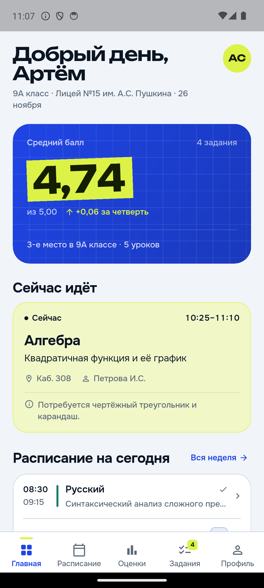
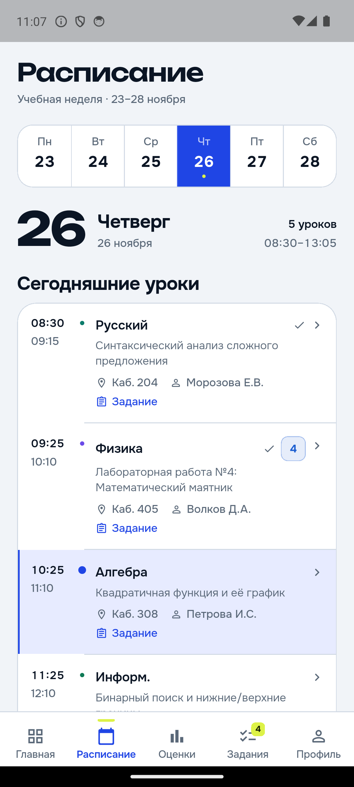
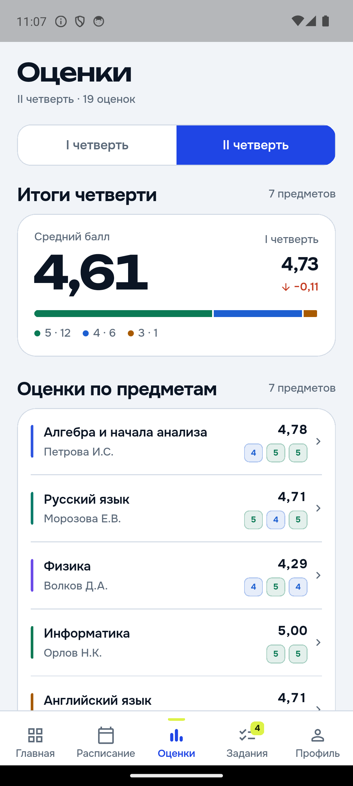
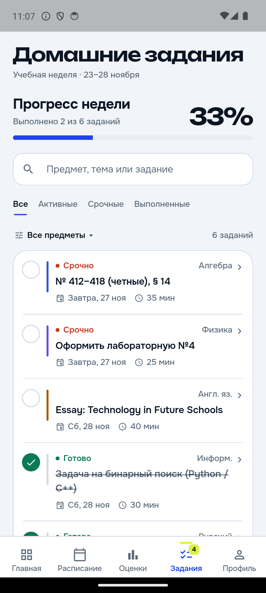
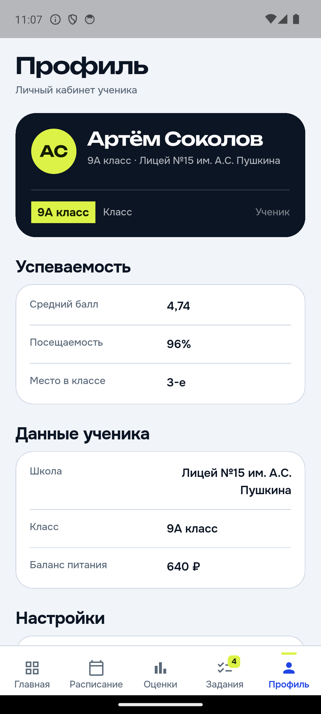
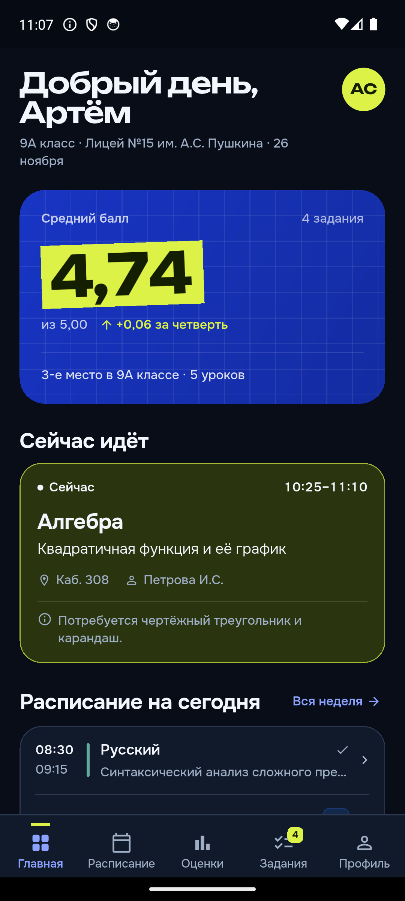

# Электронный дневник

Flutter-приложение школьного дневника: расписание, оценки, домашние задания и профиль ученика. Данные демонстрационные и хранятся локально.

## Возможности

- Главная с текущим уроком, средним баллом и расписанием на день.
- Расписание по дням недели с карточкой урока: время, кабинет, преподаватель, задание.
- Оценки по четвертям, средний балл, разбивка по предметам и весам работ.
- Домашние задания: поиск, фильтры по статусу и предмету, прогресс, детали и отметка выполнения.
- Профиль ученика, успеваемость, данные школы и настройки.
- Светлая и тёмная темы, адаптивная вёрстка для телефона и широкого экрана.
- Анимации 140–240 мс и поддержка reduced motion.

## Стек

- Flutter и Dart, Material 3.
- Шрифты [Onest](https://github.com/googlefonts/onest) и [Unbounded](https://github.com/googlefonts/unbounded), лицензия OFL.
- Без сетевых запросов и внешних сервисов: данные в `lib/data/mock_school_data.dart`.

## Запуск

```bash
flutter pub get
flutter run
```

Проверка и сборка:

```bash
dart analyze lib test
flutter test
flutter build apk --release
```

Готовый APK: `build/app/outputs/flutter-apk/app-release.apk`.

## Скриншоты

| Главная | Расписание | Оценки |
| --- | --- | --- |
|  |  |  |

| Задания | Профиль | Тёмная тема |
| --- | --- | --- |
|  |  |  |

## Структура

- `lib/screens/` — пять разделов приложения.
- `lib/widgets/shared_widgets.dart` — общие компоненты и листы.
- `lib/theme/app_theme.dart` — палитра, типографика и темы.
- `lib/models/` и `lib/data/` — модели и демонстрационные данные.
- `test/widget_test.dart` — навигация, адаптивность и общее состояние.

## Примечание о сборке

Release APK сейчас подписывается debug-ключом из `android/app/build.gradle.kts`. Для публикации в магазине нужно добавить собственный keystore и `android/key.properties`; оба файла исключены из Git.
